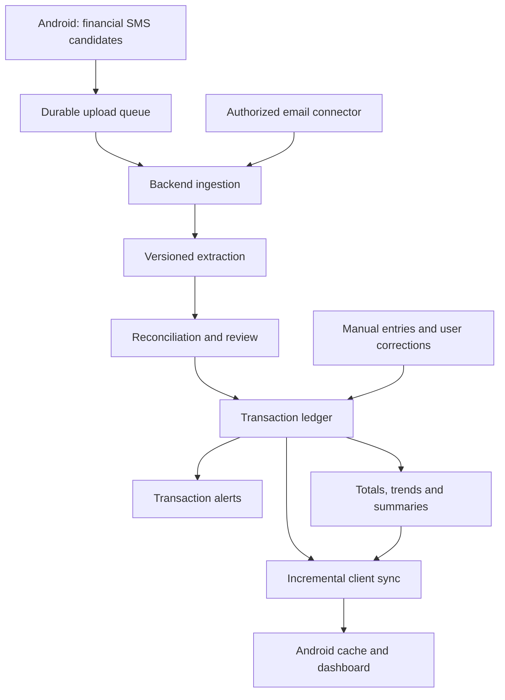

# Financial backend and reconciliation plan

**Status:** proposed direction, recorded **26 October 2026**. No backend, cloud
upload, or application migration was implemented as part of this discussion.

Related: [merge review](PR_3_REVIEW.md) and [current architecture](modularization-plan.md).

## 1. Requirements and architectural recommendation

### Requirements established in the discussion

- The product is a finance app; SMS is one capture channel.
- Financial cloud processing is optional and requires explicit opt-in. Unrelated personal SMS stay on the phone.
- Combine financial evidence from SMS and email into useful transactions and financial analysis.
- Support both on-demand analysis/reanalysis and manually entered transactions, including occasional cash spending.
- Deliver transaction alerts within a few minutes when possible, even if SMS and email arrive at different times.
- Handle repeated payments with the same amount and card/account without silently treating them as one payment.

### Recommended ownership

| Responsibility | Owner |
|---|---|
| SMS capture, local persistence, financial-candidate eligibility | Android |
| Financial classification and field extraction | Backend |
| SMS/email reconciliation and account association | Backend |
| Transaction ledger, corrections, and reconciliation decisions | Backend in cloud mode |
| Financial totals, categories, trends, and deeper analysis | Backend |
| Cached views, charts, pending edits, and offline entry | Android |
| Email ingestion | Backend connector with separately authorized access |

The backend owns the financial interpretation in cloud mode. Android retains a
small upload filter; moving financial processing does not mean uploading the
entire inbox for the server to sort out. The current classifier can serve as a
transition mechanism, but a second full financial inference engine is not a new
requirement.

Moving an existing model to a server does not establish better accuracy. The
benefits are centralized iteration, cross-source reconciliation, reprocessing,
and consistent financial rules. These come with backend operating costs and
connectivity-dependent extraction.



## 2. Financial records and processing rules

### Keep evidence, extraction, and transactions separate

- **Source evidence:** original SMS, email, or user entry, with source identity, provenance, arrival time, and any transaction timestamp stated in the content.
- **Extraction run:** versioned machine output, including extracted fields, references, parse failures, and model/parser version. Retrying extraction does not create another financial transaction by itself.
- **Transaction:** a stable financial record independent of extraction-run IDs, linked to one or more pieces of evidence.
- **User correction or reconciliation decision:** explicit edits and confirmed same/separate links, preserved across reprocessing and auditable/reversible.

Use exact decimal or minor-unit arithmetic with explicit currency. Amounts that
cannot be parsed must remain visible for review. Keep refunds, reversals,
transfers, and purchases distinct so spending totals do not simply sum every
detected movement. Compute totals deterministically; generated explanations can
describe those totals without becoming their source of truth.

### Minimum sync and processing contracts

The first implementation needs authenticated operations for:

- Ingesting financial evidence in batches with stable client event IDs and per-item acknowledgement.
- Requesting analysis/reanalysis and observing pending, completed, or failed status.
- Creating manual transactions and updating user-controlled fields with conflict detection.
- Confirming or rejecting candidate matches, including undoing an incorrect link.
- Reading incremental transaction/summary changes using a durable cursor, including deletions.

Persist a client event UUID before upload and reuse it on retries. Scope source
identifiers to the user and relevant provider/device. Deduplicating delivery of
one message is different from deciding that two messages describe one payment;
neither a message ID nor a body hash is a financial transaction identifier.

The backend must acknowledge only durably stored evidence. Processing and alert
delivery need retry-safe state; a push message is not the ledger. Late results
must not overwrite user-confirmed values or restore user-deleted records.

## 3. Reconciliation: same, separate, or unresolved

Matching is a decision about evidence, not an equality check on amount and card.
Keep these outcomes explicit:

| Outcome | Evidence and behaviour |
|---|---|
| **Same transaction** | A shared authoritative payment reference in the same bank/payment-system namespace, with compatible account, direction, currency, and event meaning; or a user-confirmed link. Attach evidence to the existing transaction. |
| **Separate transactions** | Distinct comparable payment references or other decisive evidence of different payments. Preserve both. Check event meaning so a refund or authorization/settlement transition is not misclassified as another purchase. |
| **Unresolved** | Missing references, conflicting data, or multiple plausible candidates. Preserve the evidence and show a review item. Do not silently merge or automatically add another confirmed expense. |

A merchant order ID, bank reference, email ID, and authorization code belong to
different namespaces. Do not equate them just because their strings happen to
match. Authorization and settlement can also use different identifiers, so a
different arbitrary ID does not by itself establish a second purchase.

Amount, currency, instrument, merchant, and transaction time help find
candidates. Missing fields are not matching evidence. A nearby arrival time is
not a purchase timestamp, and masked card/account suffixes alone do not provide
a complete account identity. Generic order confirmations, shipping messages,
balance updates, and OTPs do not establish that a payment occurred.

**Recommended v1 default:** use explicit reference-based rules for automatic
cross-source links and user confirmation for ambiguous composite matches. AI
may extract and normalize fields or suggest candidates; an uncalibrated model
confidence score is not sufficient authority to combine financial records.

### Repeated-payment example

```text
SMS A: INR 500, card 5678, Cafe X, transaction time 12:00, payment reference ABC
SMS B: INR 500, card 5678, Cafe X, transaction time 12:02, payment reference XYZ
Email received at 12:15: INR 500, card 5678, Cafe X; no payment reference/time
```

Assuming ABC and XYZ identify distinct payments in the same payment-reference
namespace, the SMS evidence establishes two payments and INR 1,000 spending.
The email could describe either one. Keep it as unmatched evidence; do not
silently attach it to the nearest payment or automatically create a third
expense. Let the user attach it to A or B, or confirm another payment.

The rule applies in either arrival order. If a later message could be a new
payment or a duplicate, retain it visibly as unresolved activity. Where that
uncertainty could change spending, show that totals are provisional and expose
the unresolved item rather than silently hiding a potential charge. Receipt-only
expenses may therefore require confirmation.

Two indistinguishable sources cannot support a guaranteed matching decision.
Immediate alerts and perfect duplicate prevention are not jointly guaranteed
when the evidence itself is incomplete. Preserve this limitation in the product.

## 4. Prompt alerts and asynchronous enrichment

Do not wait for both SMS and email. Process the first usable payment evidence
as an event, independently of historical backfill and scheduled summaries.

| Illustrative time | Event | Behaviour |
|---|---|---|
| 12:00 | Purchase | No source evidence received yet. |
| 12:00:10 | Bank SMS arrives | Save locally and enqueue upload promptly. |
| 12:00:30 | Backend identifies payment | Persist the transaction and enqueue an alert. |
| 12:15 | Email arrives | Reconcile it; silently enrich only if the match is established. Otherwise show unresolved evidence. |

The reverse order works when a bank payment email arrives first. A merchant
receipt can establish receipt of a purchase document without proving a bank
debit; its notification must reflect that distinction.

### Alert policy

- First credible payment evidence can produce an alert with the available amount, currency, instrument, and source. Unknown category or merchant details need not block it.
- Strongly matched later evidence updates the same transaction silently.
- A clearly separate payment produces another transaction and alert.
- Ambiguous evidence produces a visible review state rather than an unsupported claim of a new confirmed expense.
- Refunds, reversals, and other meaningful new events may warrant their own alerts.
- Reprocessing and historical imports do not replay ordinary purchase alerts by default.

Persist alert intent with ledger changes and deduplicate retries by logical
transaction/event identity. On Android, update an existing notification identity
instead of creating a fresh notification for each evidence item. When records
are later reconciled, retain identity mappings and prior alert history.

### Timing and transport

- **Proposed target:** alert within 120 seconds of the first usable source reaching the app/backend under measured online conditions. This is a design target, not a verified SLA or a guarantee from the instant of purchase.
- Android uploads use immediate one-time work, persistent retries, and suitable network constraints. Expedited work is best effort and quota-limited.
- Gmail mailbox push triggers backend fetching of changes; watch renewal and history-based recovery remain necessary. The connector cannot accelerate an email the sender has not sent yet.
- Use high-priority FCM for actual time-sensitive user-visible alerts. Include enough privacy-appropriate content to display them without depending on a second fetch. Normal-priority delivery is appropriate for silent enrichment.
- App-open delta sync and periodic recovery repair missed updates. Daily/weekly digests and expensive analysis can run on a separate schedule.

Track source arrival, durable ingestion, extraction completion, ledger update,
push submission, and device display where observable. Measure processing latency
separately from bank/merchant source delay, offline time, and push-delivery delay.

If the phone receives an SMS while offline, it can show a basic local bank-message
notice and queue processing. A rich offline alert needs local extraction; a new
full offline financial-analysis engine is not part of this proposed cloud path.
Track local notices so later server results can update or suppress repeats when
the identities can be reconciled.

## 5. Manual analysis, cash, and corrections

| Action | Behaviour |
|---|---|
| Analyse a selected financial message | Submit to the same extraction pipeline immediately; show pending/result/error status. |
| Reanalyse a transaction | Create another extraction run; preserve user-confirmed fields and reconciliation decisions. |
| Add a cash expense | Enter amount, currency, date, category, optional merchant/note, and payment method Cash. Create a user-authored transaction without requiring inference. |
| Correct an extracted transaction | Apply user-controlled fields to the stable transaction, independently of machine evidence. |
| Work offline | Save edits/entries locally with a stable ID and pending-sync state; acknowledge server acceptance explicitly. Automated cloud extraction waits for connectivity. |

Cash being infrequent calls for a small entry flow, not a separate inference
system. Full cash-wallet balance management is deferred. An ATM withdrawal is
movement into cash, not automatically spending; counting both a withdrawal and
the cash purchases would inflate expenses. Do not automatically merge a manual
entry with machine evidence solely because the amount and date match.

## 6. Migration stages and acceptance

### Stage 0 — establish a safe baseline and contracts

- Keep the [six review findings](PR_3_REVIEW.md) tracked. Fix the local banking path wherever it remains shipped; do not assume the backend proposal repairs existing code.
- Define evidence/transaction identity, financial eligibility, consent, per-user authorization, and sync/reconciliation contracts before changing writers.
- Validate one email-provider integration early, including access/verification feasibility, rather than assuming automatic Gmail access is available for a public launch.
- Keep provider credentials on the backend, isolate user data, and avoid logging raw financial content. Specify retention, deletion, and disconnect behaviour before enabling collection.

### Stage 1 — complete one financial SMS flow

- Build financial SMS capture → durable upload → backend extraction → ledger → Android cache and banking UI.
- Preserve the existing messaging experience and avoid blocking SMS receipt on network or inference.
- Add online/offline manual entries and corrections alongside this flow.
- Use a rollout switch for cloud mode. Have one financial write authority per active mode; do not let local NER and backend results independently create counted cloud transactions.

**Acceptance:** upload/processing retries do not multiply transactions; offline
capture and edits recover; opt-out does not upload; user corrections survive
reanalysis; local pending and server-accepted states are distinguishable.

### Stage 2 — validate email reconciliation

- Add independently authorized email ingestion, source-aware extraction, reference matching, and the unresolved-evidence review flow.
- Prove both arrival orders on a controlled fixture set before allowing broad automatic links.
- Keep transactions independent from source/extraction lifetimes, and retain evidence for explaining matches and reversing mistakes.

**Acceptance:** repeated same-amount/card payments remain distinct; the example
above does not become a third counted expense; receipt-only, multiple-payment
orders, refunds, and ambiguous cases have explicit outcomes.

### Stage 3 — enable alerts and financial analysis

- Implement durable alert intent, retry-safe delivery, stable notification identities, silent enrichment, and recovery sync.
- Compute currency-separated spending and income from ledger events, with explicit treatment of transfers, refunds, invalid amounts, and unresolved activity.
- Add scheduled summaries after the immediate transaction path works. Keep deeper generated commentary separate from deterministic totals.

**Acceptance:** test online latency against the proposed target, incoming work
during backfill, push retries/missed delivery, notification permission denial,
offline recovery, and suppression of alerts for historical imports/reanalysis.

### Stage 4 — migrate existing data and retire obsolete local work

- Map existing local records and user corrections to stable backend transaction IDs. Existing UI navigation uses local `extractionId`; preserve a mapping or migrate its contract rather than casting server IDs into that field.
- Keep identity across migration so re-imported SMS and migrated transactions do not become independent expenses.
- Preserve cached data and user-authored edits during rollback. Test schema/data migration; do not use destructive database recreation.
- Retire local financial NER/native packaging only after cloud behaviour, migration, opt-out behaviour, and rollback are validated. Keep existing local mode available during the transition; do not infer a permanent promise to maintain two full inference systems.

**Acceptance:** migrated corrections and account links remain available; a
rollback does not lose user entries; no enabled mode has two competing ledger
writers or repeats historical purchase alerts.

### Test and evaluation matrix

- Same amount/card/merchant repeated within minutes, with and without references; no arbitrary first-candidate match.
- Shared reference, conflicting comparable references, missing instrument identity, and identifiers from different namespaces.
- Email-first and SMS-first; missing second source; delayed, reordered, and retried ingestion.
- Authorization/settlement transitions, refunds/reversals, transfers, and split payments or multiple captures for an order.
- Manual entries, user-confirmed matches, rejected matches, edits during extraction, and undoing a bad reconciliation.
- Offline capture, app/process restart, server retry, cursor recovery, deletion propagation, and permission/consent withdrawal.
- Extraction accuracy on held-out SMS/email fixtures, false-merge rate, unresolved rate, and alert latency. Measure before making accuracy or timing claims; do not invent an automatic-match confidence percentage.

## 7. Choices still needed before implementation

These were not selected in the discussion:

- Backend language, database, queue/hosting provider, authentication, and operating budget.
- First email provider and whether the initial release is private/testing or public.
- Financial-candidate coverage and the replacement or continued use of the current broad SMS classifier.
- Long-term finance capabilities for users who do not enable cloud processing, after the legacy local pipeline is retired.
- Retention periods, deletion semantics, supported currencies/accounts, and measured automatic-match eligibility for each source template.
- Exact notification content/privacy options and the user interface for unresolved activity.

This document establishes direction and proposed defaults; it is not an
implementation-ready backend specification for those unselected services.

## References

Official platform documentation checked during the discussion:

- [Google Play SMS permissions policy](https://support.google.com/googleplay/android-developer/answer/10208820?hl=en) — financial use and restrictions on unrelated SMS data.
- [Gmail API scopes](https://developers.google.com/workspace/gmail/api/auth/scopes) — restricted read scopes, verification, and server-side security assessment requirements, subject to applicable exceptions.
- [Gmail push notifications](https://developers.google.com/workspace/gmail/api/guides/push) — backend mailbox updates, watch renewal, and recovery from delayed/dropped notifications.
- [Gmail message resource](https://developers.google.com/workspace/gmail/api/reference/rest/v1/users.messages) — message identity and arrival timestamp semantics.
- [Android work requests](https://developer.android.com/develop/background-work/background-tasks/persistent/getting-started/define-work) — expedited work and quota constraints.
- [PeriodicWorkRequest](https://developer.android.com/reference/androidx/work/PeriodicWorkRequest) — periodic execution is inexact, with a minimum interval of 15 minutes.
- [FCM Android message priority](https://firebase.google.com/docs/cloud-messaging/android-message-priority) — prompt user-visible alerts versus normal-priority background updates.
- [Plaid transaction states](https://plaid.com/docs/transactions/transactions-data/) — an example of explicit pending/posted reconciliation; this is supporting context, not a selected integration.
